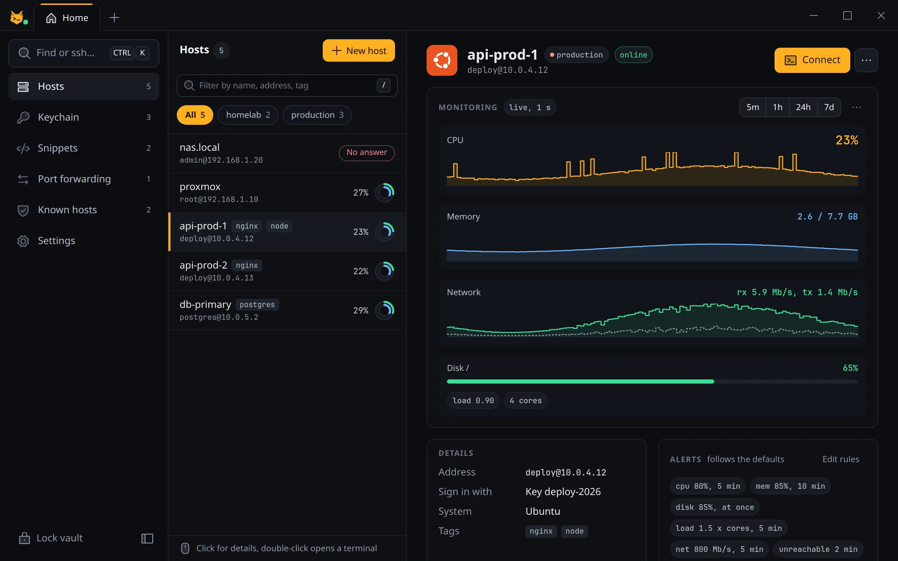
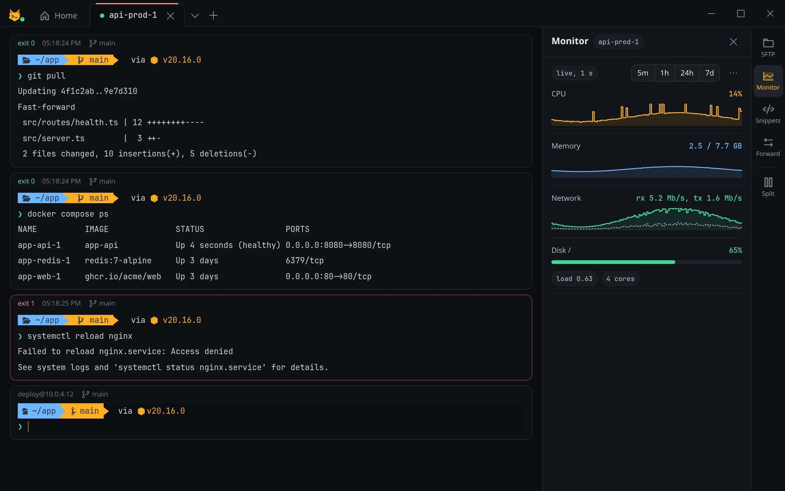
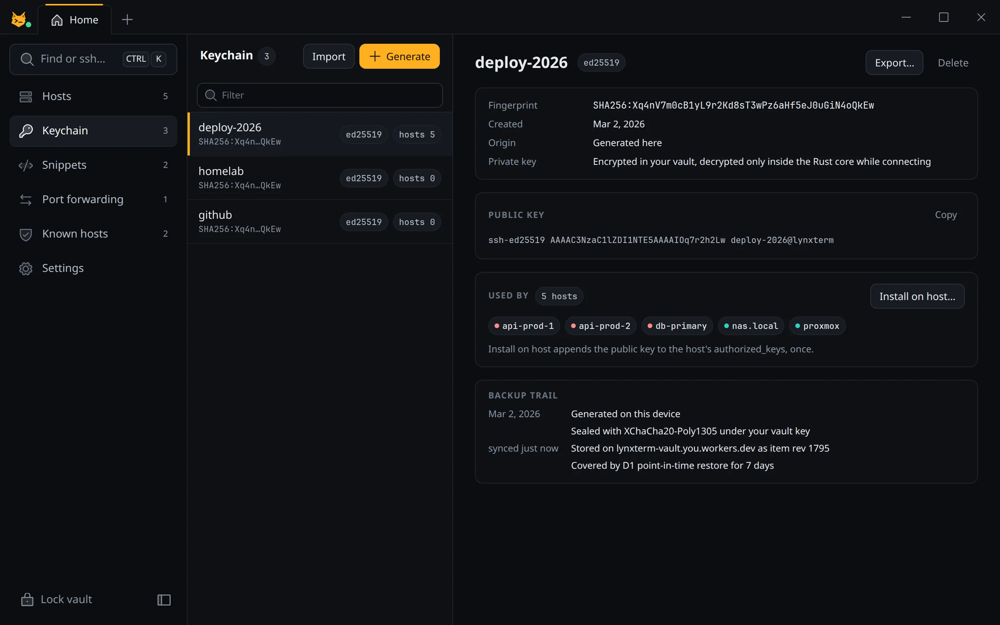
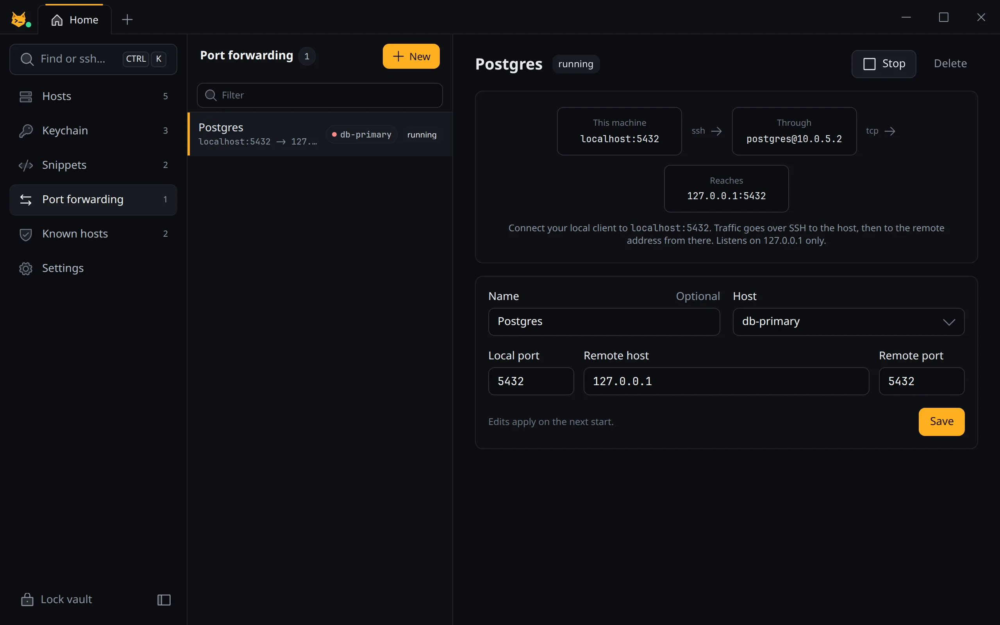
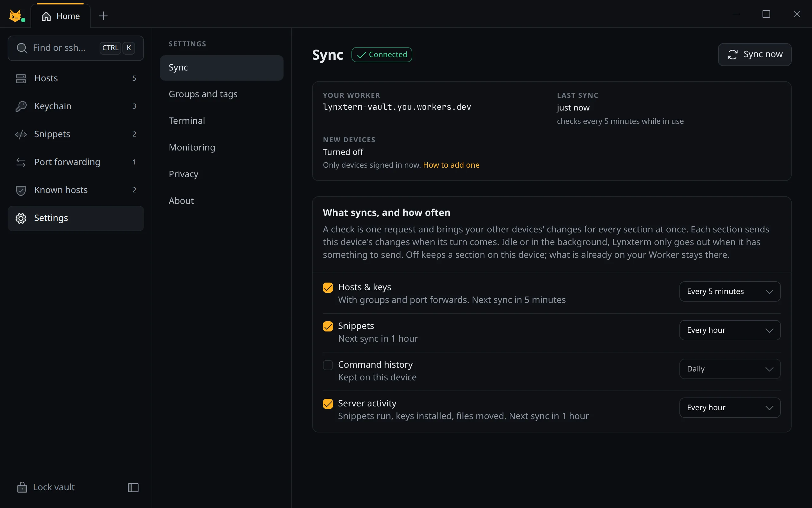
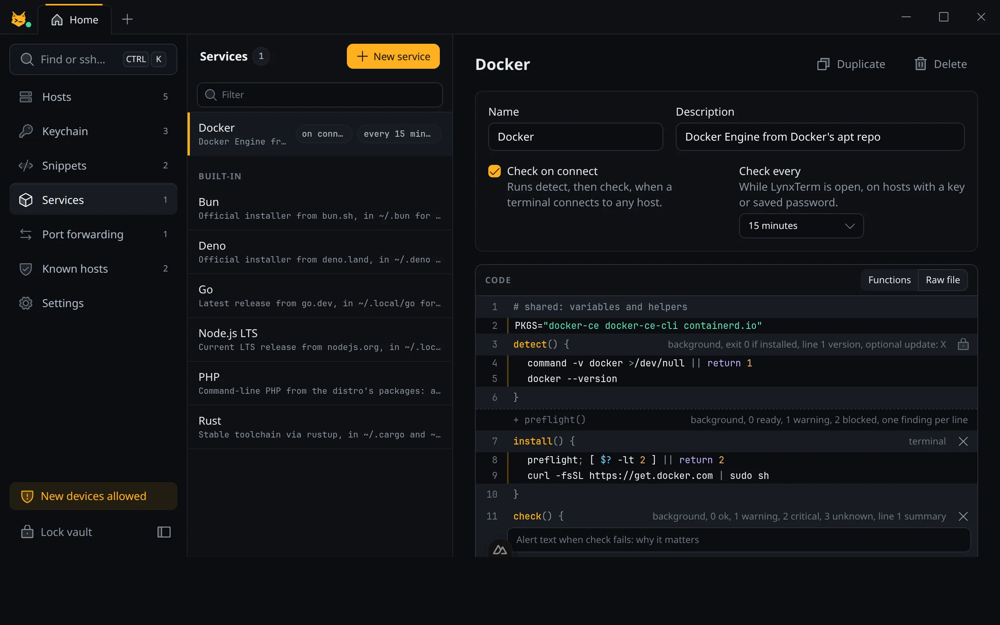

<picture>
  <source media="(prefers-color-scheme: dark)" srcset="brand/lynxterm-logo.svg">
  
</picture>

An open-source SSH client with an encrypted vault that syncs through a Cloudflare Worker on your own account.



## Features

- SSH terminal with tabs and split panes, SFTP, snippets and port forwarding
- Live server monitoring (CPU, memory, disk, load, network) with alert rules
- Hosts, groups, keys, known hosts and command history, all in one encrypted vault
- Imports hosts from `~/.ssh/config`, generates keys and installs them on your servers
- Services: see what's installed on each server, install Node, Bun, Deno, Rust, Go or PHP with one click, or write your own install and health-check scripts
- Sync between your devices through your own Worker, on Cloudflare's free plan
- macOS, Windows and Linux

<table>
  <tr>
    <td></td>
    <td></td>
  </tr>
  <tr>
    <td></td>
    <td></td>
  </tr>
</table>

## Services

A service is a small `sh` file with named functions: `detect`, `install`, `check`, `logs`, `fix`, `upgrade`, `uninstall`. Lynxterm runs them over your SSH login, so nothing stays running on the server. `detect` and `check` run in the background when you open a host; anything that needs `sudo` or shows output runs in its own terminal tab.



- Six built-ins ship with the app and install into the user's home with no sudo: Node.js LTS, Bun, Deno, Rust and Go use the official installers; PHP uses `apt` or `dnf`.
- Your own services live in the vault and sync. The editor locks the function lines, checks syntax with your local `sh`, and warns about bash-only syntax that breaks on Debian's `dash`.
- A failing `check` can offer a fix button, run on connect, or run on a schedule while the app is open. Exit codes say what happened: 0 ok, 1 warning, 2 critical.

## Download

Get the installer for your system from [Releases](https://github.com/LynxTR/lynxterm/releases).

The macOS and Windows builds aren't signed with a paid certificate yet, so the first launch shows a warning:

- macOS: open System Settings -> Privacy & Security and click Open Anyway. If macOS says the app is damaged, run `xattr -cr /Applications/Lynxterm.app` once.
- Windows: on the SmartScreen prompt, click More info, then Run anyway.

## Sync

Sync runs through a Worker with a D1 database that you deploy to your own Cloudflare account. In the app, open Settings -> Sync, copy the enrolment token, deploy, and paste the Worker's URL. Other devices join with the URL and your master password.

[](https://deploy.workers.cloudflare.com/?url=https://github.com/LynxTR/lynxterm/tree/main/apps/vault-worker)

Once all your devices are in, add a variable `NEW_DEVICES` set to `off` to the Worker on Cloudflare, so nobody else can try to sign in.

## Security

Everything is encrypted on your devices before it leaves them. The Worker stores ciphertext, revision numbers and hashed device tokens. It never sees your master password, your keys or your hostnames.

- Your master password goes through Argon2id (64 MiB, 3 passes) and gives a wrap key and a separate auth key. Only the auth key is sent, to prove the password.
- A random vault key encrypts every item with XChaCha20-Poly1305.
- A 160-bit recovery code is the only way back in if you forget the password. Recovering signs every other device out until it signs in with the new password.
- Wrong passwords get the network banned for a while, and too many from anywhere pause new sign-ins for an hour.

Found a security problem? Please report it privately through [GitHub security advisories](https://github.com/LynxTR/lynxterm/security/advisories/new) rather than in an issue.

## Build from source

You need Node.js 24, pnpm 11, Rust 1.90 or newer, and the [Tauri prerequisites](https://v2.tauri.app/start/prerequisites/) for your system.

```bash
pnpm install
pnpm -C apps/desktop tauri dev     # run the app
pnpm -C apps/desktop tauri build   # build an installer
pnpm -C apps/desktop dev           # just the UI in a browser, with sample data
```

Tests:

```bash
pnpm test
cargo test --manifest-path apps/desktop/src-tauri/Cargo.toml
```

To run the Worker locally, copy `apps/vault-worker/.dev.vars.example` to `.dev.vars` and run `pnpm -C apps/vault-worker dev`.

## Layout

- `apps/desktop`: the app, a Nuxt UI frontend with a Rust backend in `src-tauri`
- `apps/vault-worker`: the sync Worker (Cloudflare Workers and D1)
- `brand`: logos
- `docs/screenshots`: the pictures in this README, taken from the sample data in `pnpm -C apps/desktop dev`

## License

[MIT](LICENSE)
